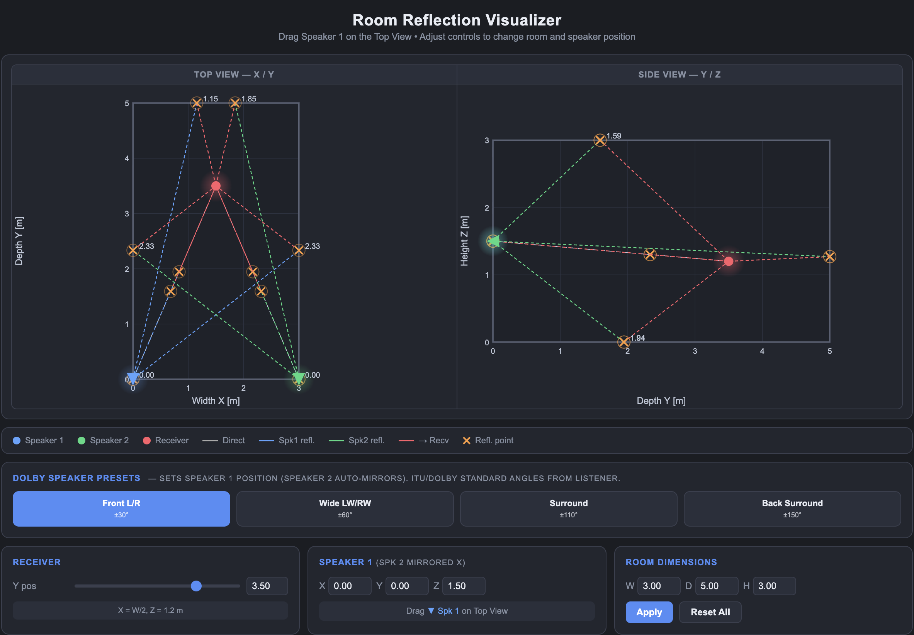

# Room Reflection Visualizer

**Live demo:** https://kongphopp.github.io/room-reflection-visualizer/

An interactive tool that shows where sound from a speaker reflects off the walls, floor and ceiling of a room before reaching the listener. I built it to help interior design teams see where acoustic absorbers should go in home cinema rooms.



## The problem

In home cinema projects, interior designers only need two answers: **where** to put acoustic panels and **how big** they should be. Clients want a room that looks beautiful and sounds good, but they are not interested in the acoustics behind it.

Without that understanding, rooms tended to go wrong in one of two ways:

- **Too live:** the room looks great, but hard surfaces make it echoey and boomy.
- **Too dead:** acoustic panels cover every wall, so the room sounds lifeless and loses its sense of space.

Treatment only needs to go where it matters, and the first reflection points are a key part of that.

## The solution

This tool turns the physics into a picture. Designers can see the exact positions and spacing where panels should go, and clients can see why those spots matter, without needing to understand the theory.

## What it does

- **Top view and side view** of a rectangular room, drawn to scale
- **Draggable speaker:** move Speaker 1 on the top view, and Speaker 2 mirrors it automatically across the room centre line
- **First-order reflection points** on all six surfaces (left/right walls, front/back walls, floor, ceiling), marked with their position in metres
- **Reflection table:** path length (m) and arrival delay (ms) for every reflection, sorted from earliest to latest
- **Speaker presets** based on common surround layout angles: Front L/R (±30°), Wide (±60°), Surround (±110°), Back Surround (±150°)
- Adjustable room dimensions, speaker height and listener position

## How it works

The tool uses the **image-source method**. To find where sound from a speaker reflects off a wall, the speaker is mirrored to the other side of that wall, creating an "image" speaker. A straight line from the image speaker to the listener crosses the wall at exactly the reflection point, because the angle of incidence equals the angle of reflection.

For each reflection:

- Path length = distance (speaker → reflection point) + distance (reflection point → listener)
- Delay = path length ÷ speed of sound (343 m/s)

## Files

| File | Description |
|---|---|
| `index.html` | Main tool. Runs in any browser with no install (HTML, CSS, JavaScript, Canvas). |
| `reflection_visualizer.py` | Earlier prototype written in Python with matplotlib widgets. |

To run the Python version:

```bash
pip install numpy matplotlib
python reflection_visualizer.py
```

## Limitations

- **First-order reflections only:** sound bouncing off two or more surfaces is not shown.
- **Specular (mirror-like) reflection:** diffusion and absorption by surface materials are not modelled.
- **Rectangular, empty room:** furniture, openings and non-rectangular shapes are not supported.
- **Fixed listener position:** the listener is always on the room centre line at 1.2 m ear height; only the front-to-back position can be changed.
- **Symmetric speaker pair:** Speaker 2 always mirrors Speaker 1.
- Preset angles are approximate placements for visualisation, not a full Dolby or ITU-R BS.775 layout check.

## Background

Built while working as a home cinema calibration engineer, where it was used to explain reflection paths to interior design teams. Developed with AI assistance (Claude).

## License

MIT
